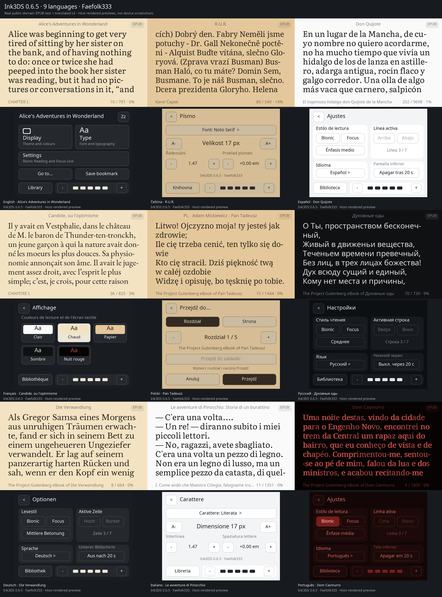

# Ink3DS

A text-first EPUB, TXT and HTML reader for the New Nintendo 3DS family.
By **Faefolk333**.

Read on the upper screen and control the reader using the lower touchscreen.
The application is free to download and use. This repository provides official
downloads, documentation, previews and third-party notices. Application source
is not published.

## Download and install

- [0.6.5 preview: languages, EPUB pictures/covers and hyphenation](https://github.com/Faefolk333/Ink3DS/releases/tag/v0.6.5)
- [0.5.1 stable](https://github.com/Faefolk333/Ink3DS/releases/latest)
- [All versions](https://github.com/Faefolk333/Ink3DS/releases)

**CIA:** install ink3ds.cia with FBI on a console with custom firmware, or use
FBI → Remote Install → Scan QR Code with the image below. The QR downloads
version 0.6.5 directly from this repository's release. It updates the existing
Ink3DS installation; the application Title ID is unchanged.

**Homebrew Launcher:** copy ink3ds.3dsx and ink3ds.smdh into /3ds/Ink3DS/.
The release's SD ZIP provides the folder layout, CIA and EN/CS guides.

New Nintendo 3DS, New 3DS XL and New 2DS XL are supported. Old 3DS is unsupported.
Choose your book folder in Library. Books stay where you place them; app-owned
preferences, bookmarks and reading positions stay under /Ink3DS/ on the SD card.

## Features in 0.6.5

- DRM-free reflowable EPUB, TXT and HTML/HTM.
- EPUB PNG/JPEG pictures at their text positions and real declared book covers.
- Light, Warm, Paper, Dark and Red Night themes.
- Eight font choices including Droid Serif and Literata; adjustable size,
  line spacing and letter spacing; Latin/Cyrillic glyph fallback.
- Optional Bionic Reading and Focus Line.
- Per-book saved positions, a toggleable bookmark and chapter/page jumps.
- Recent-first library and true lower-screen backlight sleep.
- English, Czech, Spanish, French, Polish, Russian, German, Italian and Portuguese.
  The language in Settings selects both the interface and hyphenation profile.

L/R or ZL/ZR turn pages. Up/down or Circle Pad scroll by line, or move the
Focus Line when enabled. Library directions select books; A opens one and
format filters use touch. Touch/SELECT wake the lower screen; reading controls
do not. START exits. HOME opens HOME Menu.

See the [English guide](Ink3DS-Guide-EN.txt), [český návod](Ink3DS-Navod-CS.txt),
[EPUB notes](EPUB.md), [text-layout rules/limits](TEXT-LAYOUT.md) and
[version history](CHANGELOG.md). Preview releases require physical-console
testing; host tests do not prove every console/firmware combination works.

PDF, DRM, full CSS/fixed layout, arbitrary SVG vectors, CJK and RTL shaping
are not supported. Images have size/memory limits; see the guides. Style
choices are currently session-only; language, folder and reading progress persist.

## Previews

[Language gallery and book credits](sharing/languages/README.md) ·
[More UI and reading styles](sharing/previews/overview.png)

These are host-rendered previews using the application's layout/UI, not
screenshots captured on a 3DS. Font rasterization can differ on hardware.
Only brief excerpts are shown; the original books are not bundled.

## Credits and notices

Application and supplied book artwork: **Faefolk333**. No AI-generated artwork
is used. Code and translations were developed with AI assistance; translations
are drafts and native-speaker corrections are welcome.

[Third-party licenses and required component data](LICENSES.md) remain available
separately. These licenses apply to the respective components and do not grant
an open-source license to the Ink3DS application or its artwork.

For a bug report include the version, console model/firmware, book format and
steps to reproduce. Use [Issues](https://github.com/Faefolk333/Ink3DS/issues).
