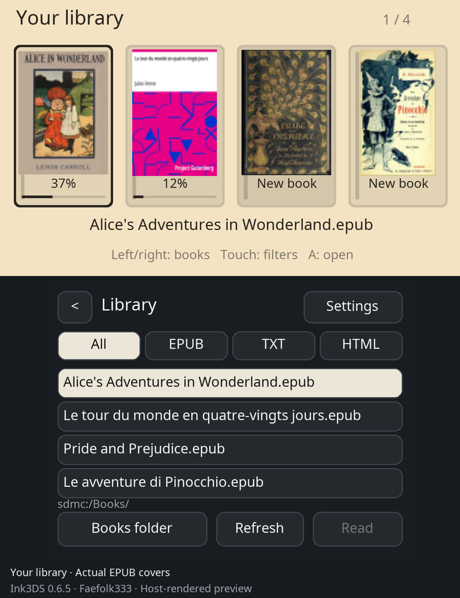

# Ink3DS 0.6.5 — library with real EPUB covers

**Host-rendered previews, not screenshots captured on a 3DS.**
The library layout and controls are captured from the application draw functions.
All four declared cover images are extracted from the actual EPUBs and processed
by the same bounded PNG/JPEG decoder used by the app (78×110 cover thumbnails).
PC font rasterization/compositing can differ from console GPU rendering.
Book filenames and reading-progress values are demonstration fixtures.
No whole books or application source are included. Original books are credited below.

[Dark theme](library-covers-dark.png) · [Czech interface](library-covers-czech.png)

| Book | Author | Original EPUB |
|---|---|---|
| Alice's Adventures in Wonderland | Lewis Carroll | [Project Gutenberg](https://www.gutenberg.org/ebooks/11) |
| Le tour du monde en quatre-vingts jours | Jules Verne | [Project Gutenberg](https://www.gutenberg.org/ebooks/800) |
| Pride and Prejudice | Jane Austen | [Project Gutenberg](https://www.gutenberg.org/ebooks/1342) |
| Le avventure di Pinocchio | Carlo Collodi | [Project Gutenberg](https://www.gutenberg.org/ebooks/52484) |
